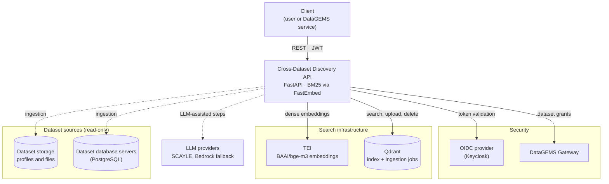
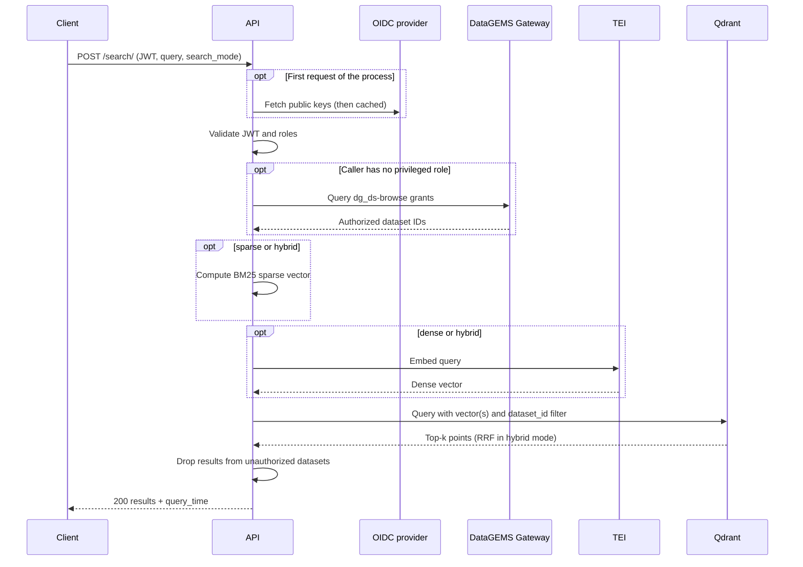
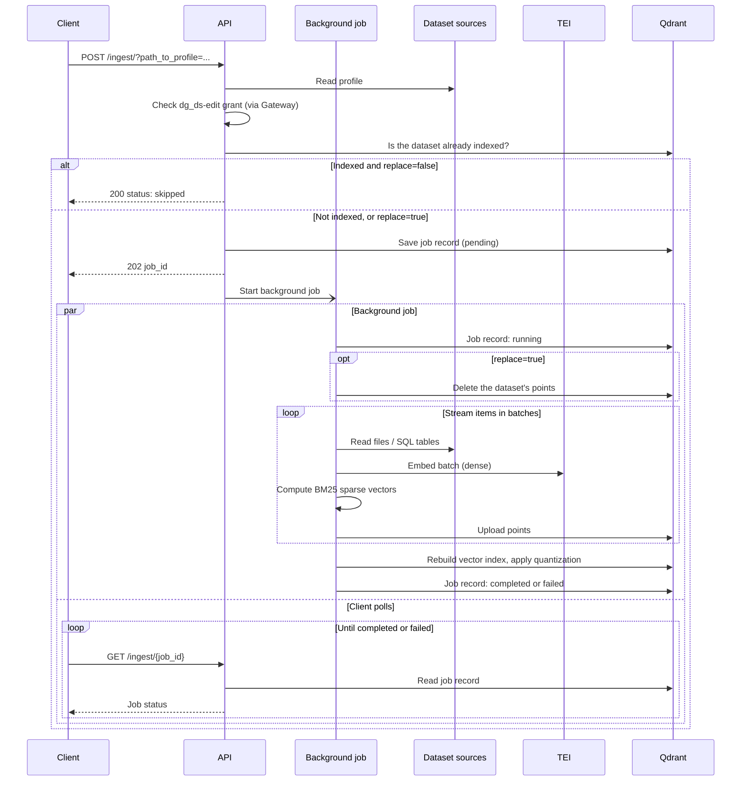

# System Architecture

The Cross-Dataset Discovery Service is part of the DataGEMS ecosystem. It indexes the content of DataGEMS datasets and lets users search across them with natural language. It orchestrates an embedding service, a vector database and, for one endpoint, an LLM.

## Core Components

*The API and the services it uses, grouped by role. TEI is deployed together with the API; the other services are shared or external. Dotted lines are used only by some endpoints.*

1. **FastAPI Application (API Pod):** The entry point of the service. It authenticates and authorizes requests, runs searches, and runs dataset ingestion as background jobs. It computes sparse (BM25) vectors locally with `FastEmbed` (CPU).

2. **Vector Database (Qdrant):** Stores the dense and sparse vectors of every indexed item, together with its text and metadata. It performs the actual retrieval: nearest-neighbour search for dense vectors, an inverted index for sparse vectors, and Reciprocal Rank Fusion (RRF) for hybrid search. It also stores the ingestion job records. See [Datastores](./datastore.md).

3. **Embedding Service (TEI Pod):** A [Hugging Face Text Embeddings Inference](https://github.com/huggingface/text-embeddings-inference) service. It produces dense vectors (`BAAI/bge-m3`, 1024 dimensions) for queries and for ingested content.

4. **Security Layer:** Validates OIDC tokens and queries the DataGEMS Gateway for the caller's dataset grants. See [Security](./security.md).

5. **LLM:** Used only by `POST /corpus-analysis-search/`, to extract the text request from a question and to score results for relevance. By default the model is served by SCAYLE (OpenAI-compatible API), with Amazon Bedrock as a fallback if a SCAYLE call fails. See [Configuration](./configuration.md#llm-corpus-analysis-search).

6. **Dataset sources (read-only):** During ingestion the API reads dataset profiles and files from mounted dataset storage, and `sql-db` datasets from the DataGEMS database servers.

## Search Flow

A `POST /search/` request goes through these steps:

*A POST /search/ request.*

1. **Auth:** The Security Layer validates the JWT and checks the caller's roles. Unless the caller has a privileged role, it fetches the IDs of the datasets the caller may browse from the DataGEMS Gateway.
2. **Filter:** If the request has `dataset_ids`, they are intersected with the authorized datasets and passed to Qdrant as a `dataset_id` filter.
3. **Vector Generation:**
    *   **Sparse mode:** The API computes a BM25 sparse vector locally.
    *   **Dense mode:** The API sends the query text to **TEI** to get a dense vector.
    *   **Hybrid mode:** Both are computed.
4. **Retrieval:** The API queries **Qdrant**:
    *   **Sparse:** Searches the sparse vectors. Qdrant applies IDF weighting.
    *   **Dense:** Searches the binary-quantized dense vectors, fetching twice as many candidates as needed and rescoring them with the full vectors.
    *   **Hybrid:** Runs both searches, then merges them with RRF.
5. **Response:** Results from datasets the caller is not authorized for are removed, and the rest are returned with their scores.

`POST /search-ap/` runs the same flow, reading its arguments from an analytical pattern and writing the results back into it.

`POST /corpus-analysis-search/` adds two LLM steps around the retrieval:

- Before step 3, the LLM rewrites the question into a text request, which is what gets searched.
- After step 4, the LLM scores each result and drops those below the threshold.

Each LLM call tries the configured providers in order. If all of them fail, the original question and the unscored results are used.

## Ingestion Flow

A `POST /ingest/` request goes through these steps:

*A POST /ingest/ request and the background job it starts.*

1. **Read profile:** The API reads the dataset profile from the dataset storage. The caller must hold a `dg_ds-edit` grant on the profile's dataset (or a privileged role).
2. **Check existing data:** If the dataset already has points in Qdrant and `replace` is false, the request returns `skipped`.
3. **Create job:** A job record (`pending`) is saved in Qdrant, the background job is scheduled, and the API returns `202` with the `job_id`.
4. **Background job:**
    1. If `replace` is true, the dataset's existing points are deleted.
    2. Items are produced, one at a time, from:
        - the dataset description;
        - each file in the profile, using the loader for its format (tables row by row, documents in token-based chunks, pre-chunked text and PDFs as given, SQL tables from the database servers).
    3. Items are processed in batches: the dense vectors come from TEI and the sparse vectors are computed locally. The resulting points are uploaded to Qdrant. Items are streamed, so large datasets are never fully loaded into memory.
    4. After the upload, Qdrant's vector indexing and quantization are applied to the collection.
    5. The job record is updated as it progresses, and finally set to `completed` (with item counts) or `failed` (with the error).

The client polls `GET /ingest/{job_id}` for progress. If the service restarts while a job is running, the job is marked `interrupted` at the next start.

`DELETE /dataset/{dataset_id}` removes all points with that `dataset_id` from Qdrant.
