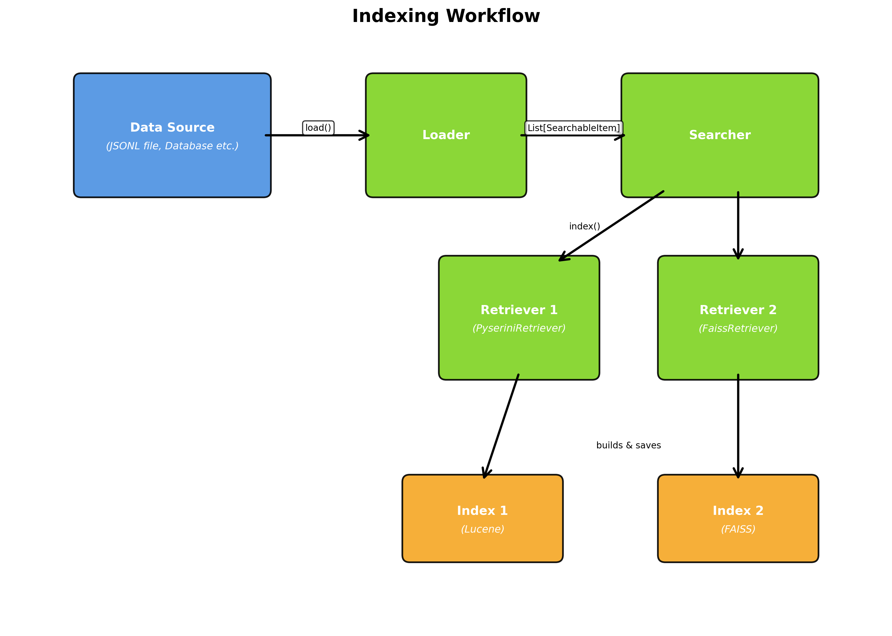
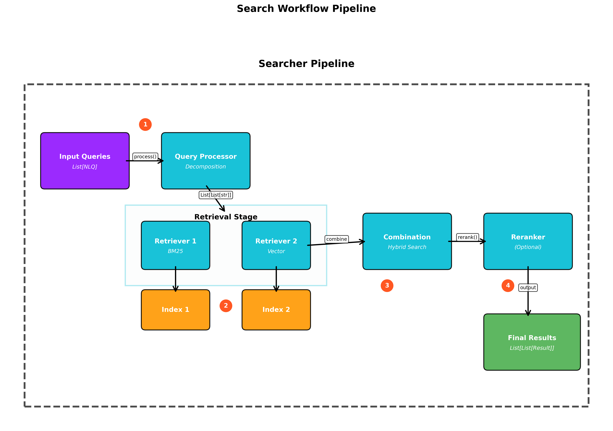
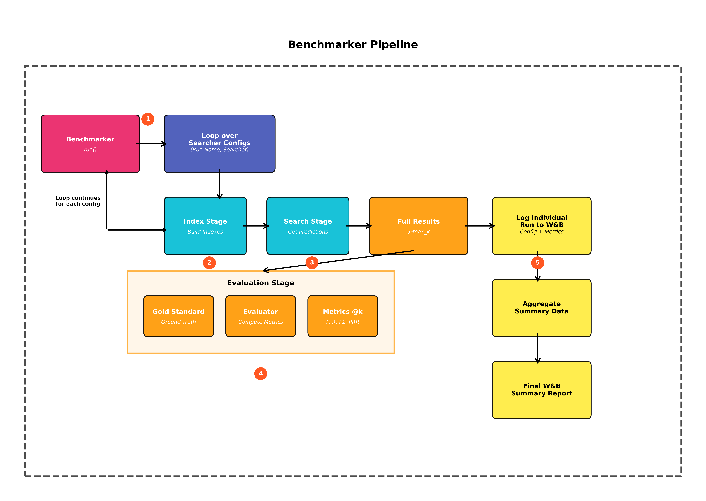

# Developer Onboarding Guide

Welcome to the developer guide for the `nlp_retrieval` framework.

This document provides an overview of the framework's architecture and a step-by-step guide for extending it with new components (like loaders, retrievers, or rerankers) and benchmarking their performance.

## Table of Contents

1. [Framework Overview](#1-framework-overview)
   * [Core Principles](#core-principles)
   * [How the Service Uses the Framework](#how-the-service-uses-the-framework)
   * [Directory Structure](#directory-structure)
   * [Core Data Models](#core-data-models)
2. [System Architecture & Workflows](#2-system-architecture-workflows)
   * [Core Components & Interfaces](#core-components-interfaces)
   * [Available Components](#available-components)
   * [Indexing Workflow](#indexing-workflow)
   * [Search Workflow](#search-workflow)
3. [Part 1: Adding a New Component](#3-part-1-adding-a-new-component)
   * [General Steps](#general-steps)
   * [Component-Specific Guides](#component-specific-guides)
   * [Assembling a Pipeline](#assembling-a-pipeline)
   * [Supporting a New File Format in the Service](#supporting-a-new-file-format-in-the-service)
4. [Part 2: Evaluating Your New Component](#4-part-2-evaluating-your-new-component)
   * [Key Evaluation Classes](#key-evaluation-classes)
   * [The Matching Logic](#the-matching-logic)
   * [How to Run a Benchmark](#how-to-run-a-benchmark)
   * [Interpreting the Output](#interpreting-the-output)
5. [Table Retrieval Benchmarks](#5-table-retrieval-benchmarks)

---

## 1. Framework Overview

The `nlp_retrieval` module provides a modular, configurable, and extensible framework for building and benchmarking end-to-end text retrieval pipelines. It is designed around a "composition over inheritance" model, where a central `Searcher` orchestrates various independent components to perform indexing and searching tasks.

### Core Principles

The framework is built on a few key principles:

- **Modularity:** Each component is a self-contained, swappable Python class.
- **Clear Interfaces:** Components inherit from an Abstract Base Class (ABC) that defines a strict contract for its methods.
- **Standardized Data Flow:** We use Pydantic models (`SearchableItem`, `RetrievalResult`) to pass data between components.
- **Batch-First Design:** All components are designed to operate on batches (`List`) of queries or results, enabling efficient processing.

### How the Service Uses the Framework

The Cross-Dataset Discovery API is built on this framework. It uses a `Searcher` with a single retriever, `QdrantHybridRetriever` (sparse, dense and hybrid search in Qdrant), and no query processor or reranker. For ingestion it uses the file-format loaders (`CsvLoader`, `XlsxLoader`, `JsonLoader`, `DocxLoader`, `PptxLoader`, `IpynbLoader`, `SqlDbLoader`, `ChunkedContentLoader`). See [Architecture](./architecture.md).

The other components (FAISS, Pyserini/BM25, ColBERT, the rerankers, query processors, and the table retrieval methods) are used for research and benchmarking.

### Directory Structure

All retrieval-related code resides in `cross_dataset_discovery/darelabdb/nlp_retrieval/`.

```
nlp_retrieval/
├── core/                      # Pydantic models
├── loaders/                   # Reads data from sources
├── user_query_processors/     # Processes raw user queries
├── retrievers/                # Indexes data and retrieves candidates
├── rerankers/                 # Re-scores and ranks candidates
├── evaluation/                # Tools for calculating metrics
├── benchmarking/              # Orchestrator for running benchmarks
├── table_retrieval_scripts/   # Unified indexing/benchmark scripts for table retrieval
├── docs/                      # Framework documentation
└── searcher.py                # The main pipeline orchestrator
```

Each component type has its ABC in its own folder (`loaders/loader_abc.py`, `retrievers/retriever_abc.py`, `rerankers/reranker_abc.py`, `user_query_processors/query_processor_abc.py`).

### Core Data Models

Before you start, familiarize yourself with the two fundamental data models defined in `darelabdb/nlp_retrieval/core/models.py`:

- **`SearchableItem`**: The canonical representation of a single piece of data to be indexed.
  - `item_id: str`: A unique identifier for the item.
  - `content: str`: The main text content used for retrieval.
  - `metadata: Dict`: A dictionary for any associated metadata.
- **`RetrievalResult`**: Represents a single item returned by a search.
  - `item: SearchableItem`: The retrieved item.
  - `score: float`: The relevance score assigned by the retriever or reranker.

---

## 2. System Architecture & Workflows

The framework is built upon a set of abstract base classes (ABCs), each defining a specific role in the retrieval pipeline. The `Searcher` and `Benchmarker` classes orchestrate the interaction between these components.

### Core Components & Interfaces

- **`BaseLoader`**: Loads data from a source (e.g., file, database) and converts it into `SearchableItem`s.
- **`BaseUserQueryProcessor`**: Transforms a batch of user queries into a format suitable for retrieval (e.g., decomposition, keyword extraction).
- **`BaseRetriever`**: Manages the indexing of `SearchableItem`s and the retrieval of candidate results.
- **`BaseReranker`**: Re-scores a list of candidate `RetrievalResult`s to improve ranking quality.

### Available Components

| Type | Classes |
| :--- | :--- |
| **Loaders** (files) | `CsvLoader`, `XlsxLoader`, `JsonLoader`, `DocumentJsonLoader`, `DocxLoader`, `PptxLoader`, `IpynbLoader`, `ChunkedContentLoader`, `DataframesLoader`, `TableJsonLoader` |
| **Loaders** (databases) | `SqlDbLoader` (SQLAlchemy URL) |
| **Loaders** (table retrieval methods) | `AutoDDGLoader`, `BirdieLoader`, `JarTableLoader`, `PneumaLoader`, `QGpTLoader`, `TableRAGLoader` |
| **Retrievers** | `QdrantHybridRetriever`, `FaissRetriever` (dense), `PyseriniRetriever` (BM25), `ColBERTRetriever`, `RagatouilleColbertRetriever`, `MinHashLshRetriever`, `BirdieRetriever`, `PneumaRetriever`, `TableRAGRetriever` |
| **Rerankers** | `MxbaiCrossEncoderReranker`, `BgeReranker`, `SentenceTransformerCrossEncoderReranker`, `BiEncoderReranker`, `LLMReranker`, `BridgeReranker`, `JarMIPReranker`, `PneumaReranker` |
| **Query processors** | `PassthroughQueryProcessor` (default), `DecompositionProcessor`, `KeywordExtractorProcessor`, `KeyBERTProcessor`, `NERQueryProcessor`, `NgramQueryProcessor`, `JarDecompositionProcessor`, `TableRAGQueryProcessor` |

### Indexing Workflow

The indexing process is initiated by the `Searcher.index(loader, output_path)` method.

1. **Load**: The loader (e.g., `JsonLoader`) loads the data into a `List[SearchableItem]`.
2. **Index**: The `Searcher` passes this list to the `index()` method of each configured retriever (e.g., `PyseriniRetriever`, `FaissRetriever`), each with its own subdirectory of `output_path`, named after the retriever's class.
3. **Store**: Each retriever builds its specific index (e.g., a Lucene index, a FAISS vector index) and saves it in that subdirectory.

`QdrantHybridRetriever` is the exception: it stores everything in Qdrant and ignores `output_path`.


*Figure 1: The indexing workflow showing data flow from source through loader to multiple retrievers creating their respective indexes.*

### Search Workflow

The search process is initiated by the `Searcher.search(nlqs, output_path, k, **kwargs)` method.

1. **Process Query**: The input queries are passed to the configured `BaseUserQueryProcessor` (`PassthroughQueryProcessor` if none is set).
2. **Retrieve**: The `Searcher` passes the processed queries to each configured retriever, asking each for `k × reranker_multiplier` candidates (default multiplier `3`). Extra keyword arguments are passed through to the retrievers; `QdrantHybridRetriever` uses them for `search_mode` and `filters`.
3. **Combine (Hybrid Search)**: The `Searcher` collects the results from all retrievers into a single pool of candidates, deduplicated by `item_id`.
4. **Rerank (Optional)**: If a `BaseReranker` is configured, this combined pool is passed to its `rerank()` method for re-scoring.
5. **Return**: The final results are returned, sorted by score and truncated to `k` per query.


*Figure 2: The complete search pipeline from query input through processing, retrieval, combination, and optional reranking.*

---

## 3. Part 1: Adding a New Component

### General Steps

1. **Identify the Component Type:** Determine which category your new class falls into: `loaders`, `user_query_processors`, `retrievers`, or `rerankers`.
2. **Create the File:** Add a new Python file in the appropriate directory (e.g., `cross_dataset_discovery/darelabdb/nlp_retrieval/retrievers/my_new_retriever.py`).
3. **Inherit from the ABC:** Your new class must inherit from the correct Abstract Base Class (e.g., `BaseRetriever` from `retriever_abc.py`).
4. **Implement All Abstract Methods:** Implement every method marked with `@abstractmethod` in the parent ABC. Make sure your method signatures match the ABC exactly.
5. **Use Core Data Models:** Your component must accept and/or return the Pydantic models (`SearchableItem`, `RetrievalResult`) as defined in the ABC contract.

### Component-Specific Guides

#### Creating a New Loader

- **Inherit from:** `BaseLoader`
- **Implement:**
  - `__init__(self, ...)`: Accept necessary parameters, like file paths or connection details.
  - `load(self) -> List[SearchableItem]`: Read your data source and create a list of `SearchableItem` objects.
- **Optionally override:**
  - `load_stream(self) -> Generator[SearchableItem, None, None]`: Yield items one at a time instead of building the whole list. The default implementation calls `load()`. The service's ingestion uses `load_stream()`, so override it for any loader that can produce large amounts of data.

#### Creating a New User Query Processor

- **Inherit from:** `BaseUserQueryProcessor`
- **Implement:**
  - `__init__(self, ...)`: Accept any configuration for your processing logic.
  - `process(self, nlqs: List[str]) -> List[List[str]]`: Receives a list of raw queries and returns a list of lists, where each inner list contains the processed strings (e.g., sub-queries, keywords) for one input query. The output must have the same length as `nlqs`.

#### Creating a New Retriever

- **Inherit from:** `BaseRetriever`
- **Implement:**
  - `__init__(self, ...)`: Initialize your retrieval model, parameters, etc.
  - `index(self, items: List[SearchableItem], output_path: str) -> None`: Build your search index from the items' `content`, store whatever is needed to rebuild the `SearchableItem`s at retrieval time, and save all index files inside `output_path`.
  - `retrieve(self, processed_queries_batch: List[List[str]], output_path: str, k: int, **kwargs) -> List[List[RetrievalResult]]`: Load the index and process all sub-queries of each original query. Return one aggregated, deduplicated list of `RetrievalResult` objects per original query (the output must have the same length as `processed_queries_batch`). Use `**kwargs` for retriever-specific options.

#### Creating a New Reranker

- **Inherit from:** `BaseReranker`
- **Implement:**
  - `__init__(self, ...)`: Initialize your reranking model.
  - `rerank(self, nlqs: List[str], results_batch: List[List[RetrievalResult]], k: int) -> List[List[RetrievalResult]]`: For each query and its candidates, compute new scores, sort the results in descending order, and truncate them to the top `k`. The output must have the same length as `nlqs`.

### Assembling a Pipeline

Once you have created your custom component, you can use it in a `Searcher` pipeline.

```python
from darelabdb.nlp_retrieval.searcher import Searcher
from darelabdb.nlp_retrieval.loaders.json_loader import JsonLoader
from darelabdb.nlp_retrieval.retrievers.dense_retriever import FaissRetriever
# Import your new custom component
from darelabdb.nlp_retrieval.rerankers.my_reranker import MyReranker

# 1. Initialize the components
my_loader = JsonLoader(
    file_path="path/to/data.jsonl",       # .json (array) or .jsonl
    item_id_prefix="my-dataset:data.jsonl",
    content_fields=["text"],
)
my_retriever = FaissRetriever(model_name_or_path="BAAI/bge-m3")
my_custom_reranker = MyReranker(model_name="some-model")  # Your new reranker

# 2. Assemble the Searcher
searcher = Searcher(
    retrievers=[my_retriever],
    reranker=my_custom_reranker,
)

# 3. Build the index
INDEX_DIR = "./my_index"
searcher.index(loader=my_loader, output_path=INDEX_DIR)

# 4. Search
queries = ["what is the capital of france?", "what is the best gpu for gaming?"]
results = searcher.search(nlqs=queries, output_path=INDEX_DIR, k=5)

print(results)
```

### Supporting a New File Format in the Service

To let the API ingest a new file format:

1. Create a loader for it, as described above, and implement `load_stream()`.
2. Add a branch for the format's `original_format` value in `_build_items()` in `darelabdb/api_datagems_cross_dataset_discovery/app/main.py`, creating your loader with the file's path and the shared `metadata` (`dataset_id`, `file_object_id`, `original_filename`).
3. Document the format in the [API Overview](./api-overview.md#dataset-profile).

---

## 4. Part 2: Evaluating Your New Component

After creating a new component, the next step is to measure its performance. The framework provides tools to run automated benchmarks and calculate standard information retrieval metrics.


*Figure 3: The benchmarking pipeline showing the complete flow from configuration through evaluation and logging.*

### Key Evaluation Classes

- **`RetrievalEvaluator`** (`darelabdb/nlp_retrieval/evaluation/evaluator.py`): The core engine for calculating metrics such as Precision, Recall, F1-Score and Perfect Recall.
- **`Benchmarker`** (`darelabdb/nlp_retrieval/benchmarking/benchmarker.py`): The high-level orchestrator. It runs different `Searcher` configurations, calls the `RetrievalEvaluator`, and logs results to the console and to Weights & Biases.

### The Matching Logic

This is the most important concept in our evaluation system. A predicted item is considered a "correct hit" if its metadata contains all the key-value pairs of a gold standard item's metadata.

**Example:**

- Gold Standard Metadata: `{'page_title': 'Mashable', 'source': 'some_sentence'}`
- Prediction 1 Metadata: `{'page_title': 'Mashable', 'source': 'some_sentence', 'value': 'xyz'}` → **MATCH** (a superset)
- Prediction 2 Metadata: `{'page_title': 'Mashable', 'source': 'another_sentence'}` → **NO MATCH**

The evaluator also handles granularity automatically. When computing metrics `@k`, `k` refers to the number of *unique entities*, as defined by the gold standard's metadata keys. For example, if the gold standard metadata is `{'page_title': 'A'}`, the predictions are first deduplicated to keep only the first item for each unique `page_title`, and the metrics are calculated on that list.

### How to Run a Benchmark

The table retrieval script `table_retrieval_scripts/run_benchmark.py` is a complete example of setting up and running an evaluation.

#### Step 1: Prepare the Corpus Loader

The `Benchmarker` does not depend on your data's format. It only needs an initialized loader whose `load()` method returns a `List[SearchableItem]`.

```python
from darelabdb.nlp_retrieval.loaders.json_loader import JsonLoader

loader = JsonLoader(
    file_path="path/to/corpus.jsonl",
    item_id_prefix="corpus",
    content_fields=["title", "abstract"],      # each field becomes a separate item
    record_id_field="id",
    metadata_fields=["page_title", "source"],  # None = all remaining fields
)
```

#### Step 2: Prepare Queries and Gold Standard

The `Benchmarker` does not read a specific benchmark file. You create two lists in memory:

- `queries: List[str]`: A list of query strings.
- `gold_standard: List[List[RetrievalResult]]`: A parallel list, where each inner list contains the correct `RetrievalResult` objects for the corresponding query.

For the gold standard, only the `metadata` of each item is used for matching; `item_id` and `content` can be placeholders:

```python
from darelabdb.nlp_retrieval.core.models import RetrievalResult, SearchableItem

gold_item = SearchableItem(
    item_id="placeholder",
    content="placeholder",
    metadata={"page_title": "Mashable", "source": "some_sentence"},
)
gold_standard_for_one_query = [RetrievalResult(item=gold_item, score=1.0)]
```

#### Step 3: Configure Your Searcher Pipelines

Create an initialized `Searcher` instance for each configuration you want to test, including your new component.

```python
from darelabdb.nlp_retrieval.retrievers.bm25_retriever import PyseriniRetriever

# Configuration 1: Baseline
bm25_searcher = Searcher(retrievers=[PyseriniRetriever()])

# Configuration 2: Your new component
my_new_searcher = Searcher(retrievers=[MyNewRetriever()])

# Create a list of named configurations for the Benchmarker
searcher_configs = [
    ("BM25_Baseline", bm25_searcher),
    ("My_New_Retriever", my_new_searcher),
]
```

`PyseriniRetriever` requires a Java 21 JDK.

#### Step 4: Initialize and Run the Benchmarker

Pass all the prepared objects to the `Benchmarker` and call `.run()`.

```python
from darelabdb.nlp_retrieval.benchmarking.benchmarker import Benchmarker
from darelabdb.nlp_retrieval.evaluation.evaluator import RetrievalEvaluator

evaluator = RetrievalEvaluator()
benchmarker = Benchmarker(
    searcher_configs=searcher_configs,
    evaluator=evaluator,
    loader=loader,
    queries=queries,
    gold_standard=gold_standard,
    k_values=[1, 5, 10],
    output_path="./benchmark_results",
    use_wandb=True,
    wandb_project="my-retrieval-project",
    wandb_entity="my-username",
)

benchmarker.run()
```

### Interpreting the Output

- **Console Output**: For each configuration, the indexing status, the search speed (queries per second), the metrics for the full retrieved set, and the metrics `@k` for each value in `k_values`. At the end, a summary table compares all runs at the largest `k`.
- **Weights & Biases (W&B) Dashboard**: If `use_wandb=True`, the `Benchmarker` creates:
    - one run per configuration, with the configuration of all its components, the final metrics, and a `performance_metrics_at_k` table;
    - a `Benchmark_Summary_Report` run, with a `benchmark_summary_table` comparing all configurations.

---

## 5. Table Retrieval Benchmarks

The framework includes a suite for evaluating **table retrieval** methods, documented in detail in `nlp_retrieval/docs/TABLE_RETRIEVAL.md`.

- **Methods:** standard baselines (`bm25`, `dense`, `colbert`) and LLM-augmented or specialized methods (`autoddg`, `birdie`, `jar`, `pneuma`, `qgpt`, `tablerag`).
- **Data:** The benchmarks are stored in the `DARELab/table_retrieval_data` Hugging Face dataset repository. Each benchmark has a `corpus.json` (the tables) and a `queries.json` (queries with their gold `table_ids`). Only the requested benchmarks are downloaded and cached.
- **Scripts:** `table_retrieval_scripts/run_indexing.py` builds the indexes (and caches any LLM-generated augmentations), and `table_retrieval_scripts/run_benchmark.py` evaluates them. Both take `--method <name>` or `--method all`. They load each method's models once and process all benchmarks with it before moving to the next method, so that large LLMs do not exhaust GPU memory.
- **Benchmark registry:** The scripts load the benchmarks through the `darelabdb.utils_datasets` package of the DARELab monorepo (`table_retrieval_benchmarks.py`), where new benchmarks are registered.
